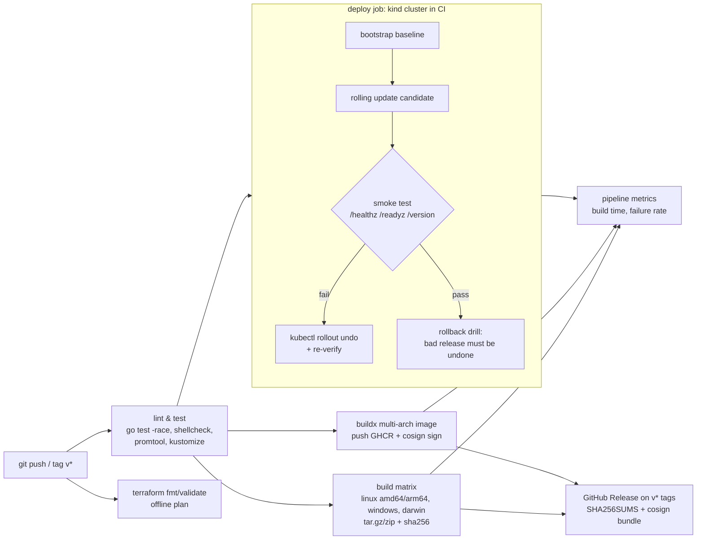
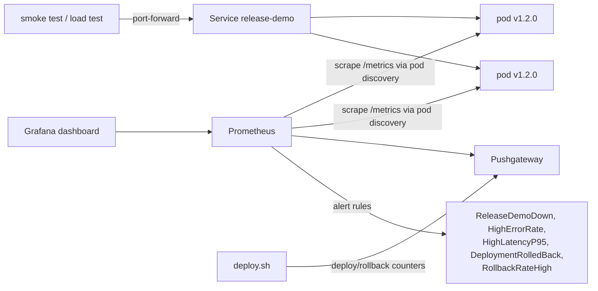
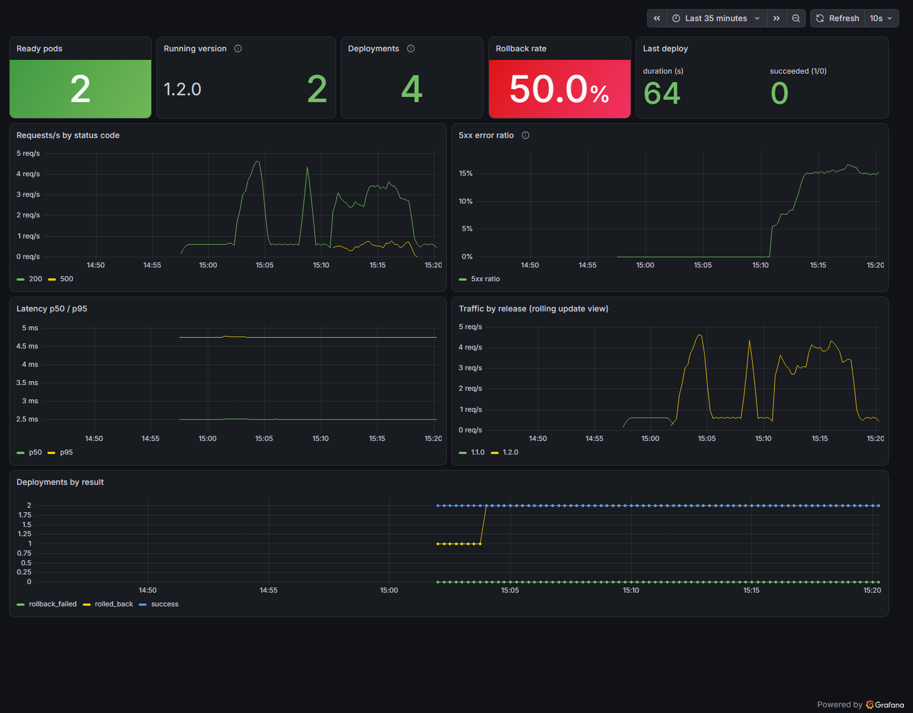

# devops-release-pipeline

A personal DevOps lab that takes a small Go service from commit to a running
Kubernetes deployment with **versioned and signed artifacts**, a **smoke-test
gate with automatic rollback**, **Prometheus/Grafana monitoring of the service
and of the delivery process itself**, and **Terraform for a minimal AWS
footprint** (planned, never applied).

> **Scope:** this is a personal learning lab, not a production system. The
> Kubernetes cluster is [kind](https://kind.sigs.k8s.io/) (local or inside CI),
> and the AWS code runs only `terraform validate` and an offline `plan`. What has
> and has not been verified is listed in [Verification](#verification).

## What it shows

| Area | Implementation |
|---|---|
| CI/CD | GitHub Actions: lint/test, 4-platform build matrix, multi-arch image, deploy, release ([`ci.yml`](.github/workflows/ci.yml)) |
| Artifact versioning | Semver from git tags + commit SHA embedded in the binary, image tags and `/version` ([`version.sh`](scripts/version.sh)) |
| Packaging & integrity | `tar.gz`/`zip` per platform with SHA-256, combined `SHA256SUMS` ([`package.sh`](scripts/package.sh)) |
| Signing | cosign keyless (GitHub OIDC) for the image digest and for `SHA256SUMS` on releases; verified in the same job |
| Containers | Multi-stage Dockerfile, static binary on distroless `nonroot` (15 MB, UID 65532, read-only root FS) |
| Kubernetes | Deployment with readiness/liveness probes, resource limits, `maxUnavailable: 0`, PDB, HPA, restricted Pod Security ([`deploy/k8s`](deploy/k8s)) |
| Deploy safety | Rolling update, then smoke test; any failure triggers `kubectl rollout undo` and re-verifies the old version ([`deploy.sh`](scripts/deploy.sh)) |
| Monitoring | Prometheus (pod discovery), Pushgateway, Grafana dashboard as code, 5 alert rules with `promtool` unit tests ([`deploy/monitoring`](deploy/monitoring)) |
| Delivery metrics | Build time per target, job timing, failure rate over recent runs, deploy/rollback rate ([`pipeline_metrics.py`](scripts/pipeline_metrics.py)) |
| AWS (IaC) | VPC, 2 public subnets, SG, EC2 (IMDSv2, SSM, no SSH), versioned S3 artifact bucket with lifecycle, least-privilege IAM, GitHub OIDC role ([`infra/terraform/aws`](infra/terraform/aws)) |
| Troubleshooting | Write-ups for CrashLoopBackOff, Service selector mismatch, and a real OOMKill found while building this lab ([`docs/troubleshooting`](docs/troubleshooting)) |

## Architecture



Runtime view (local lab):



## Repository layout

```
app/                    Go service (stdlib only): /, /healthz, /readyz, /version, /metrics, /api/work
Dockerfile              multi-stage build -> distroless nonroot
scripts/                version, package, bootstrap, deploy (+rollback), smoke test, load test, metrics
deploy/kind/            kind cluster config (local and CI)
deploy/k8s/             Kustomize base (Deployment, Service, HPA, PDB) + kind overlay
deploy/monitoring/      Prometheus, Pushgateway, Grafana; alerts.yml + alerts_test.yml; dashboard JSON
infra/terraform/aws/    VPC, subnets, SG, EC2, S3, IAM, GitHub OIDC (validate/plan only)
tests/                  Python unit tests for pipeline_metrics.py
docs/                   troubleshooting write-ups, case study, verification evidence
```

## Run it locally

Requirements: Docker, `kubectl`, [kind](https://kind.sigs.k8s.io/), Go 1.24+,
Python 3, Bash (Git Bash works on Windows). About 3 GB of disk for images.

```bash
# 1. tests
(cd app && go test ./...) && python3 -m unittest discover -s tests

# 2. cluster + images
kind create cluster --config deploy/kind/cluster.yaml
docker build -t release-demo:1.0.0 --build-arg VERSION=1.0.0 .
docker build -t release-demo:1.1.0 --build-arg VERSION=1.1.0 .
kind load docker-image release-demo:1.0.0 release-demo:1.1.0 --name release-lab

# 3. first install, then a normal deploy
scripts/bootstrap.sh release-demo:1.0.0 1.0.0
scripts/deploy.sh release-demo:1.1.0 1.1.0

# 4. a bad release: probes fail, deploy.sh rolls back to 1.1.0 and exits 3
ROLLOUT_TIMEOUT=60s scripts/deploy.sh release-demo:1.1.0 1.2.0-bad --fail-mode unhealthy

# 5. monitoring
scripts/monitoring_up.sh
kubectl -n monitoring port-forward svc/grafana 3000:3000      # http://127.0.0.1:3000
kubectl -n monitoring port-forward svc/pushgateway 9091:9091
PUSHGATEWAY_URL=http://127.0.0.1:9091 scripts/deploy.sh release-demo:1.0.0 1.0.0
scripts/load_test.sh 120 8

# clean up
kind delete cluster --name release-lab
```

Fault injection used by the drills: `FAIL_MODE=unhealthy` (probes return 503),
`FAIL_MODE=crash` (exit on start, CrashLoopBackOff), `ERROR_RATE=0.2` (20% of
`/api/work` returns 500).

## Reading the results

- **`deploy.sh` exit codes:** `0` deployed and smoke-tested, `3` failed but
  rolled back (service kept running), `4` rollback failed (needs a human). Every
  attempt appends a JSON line to `.state/deploy-events.jsonl`.
- **CI job summary:** version, coverage, Terraform plan line, image digest and
  signature, deploy results, build matrix timing, job durations and the failure
  rate of the last 50 runs. The same data is uploaded as the `pipeline-metrics`
  and `deploy-events` artifacts.
- **Grafana:** top row = ready pods, running version(s), deployment count,
  rollback rate, last deploy; then request rate by status code, 5xx ratio,
  p50/p95 latency, traffic by release (shows the switch during a rolling update)
  and deployments by result.



*Local kind run, 16 Nov 2026: 4 deployments of which 2 were rolled back
(50%, red), then a 20% error-injection drill visible in the 5xx ratio panel.*

- **Verifying a signed image:**

```bash
cosign verify ghcr.io/giabao2110/devops-release-pipeline@sha256:<digest> \
  --certificate-identity-regexp '^https://github.com/Giabao2110/devops-release-pipeline/.github/workflows/ci.yml@' \
  --certificate-oidc-issuer https://token.actions.githubusercontent.com
```

- **Verifying release archives:** download the archive, `SHA256SUMS` and
  `SHA256SUMS.sigstore.json`, then `cosign verify-blob --bundle SHA256SUMS.sigstore.json ... SHA256SUMS`
  and `sha256sum -c SHA256SUMS --ignore-missing`.

## Verification

Everything below was run on a Windows 11 laptop (Docker Desktop, kind v0.33.0
with Kubernetes v1.37, Go 1.26, Terraform 1.17.2) on 16 Nov 2026. Commands and
trimmed output are in [`docs/evidence/`](docs/evidence/README.md).

| Check | Result |
|---|---|
| Go unit tests (`go vet`, `go test -cover`) | pass, 78% statement coverage |
| Python tests for `pipeline_metrics.py` | 8 tests pass |
| shellcheck on all scripts | clean |
| `promtool check rules` + `promtool test rules` | 5 rules, all tests pass |
| Docker image | 15 MB, runs as `65532:65532` |
| kind: bootstrap 1.0.0 -> deploy 1.1.0 | rolled out, smoke test pass |
| kind: bad release (`FAIL_MODE=unhealthy`) | rollout timed out after 60 s, auto `rollout undo`, old version re-verified, exit 3 |
| kind: bad release under load (`FAIL_MODE=crash`) | CrashLoopBackOff detected, rolled back; 0 failed requests out of 496 during the drill |
| Troubleshooting drills | CrashLoopBackOff and selector mismatch reproduced and fixed |
| Prometheus | all targets up, both delivery alerts fired after the rollback drills |
| Grafana | dashboard provisioned from JSON; found and fixed a start-up OOMKill |
| Error-rate alert | `ERROR_RATE=0.2` drill: 243 of 1264 requests failed, `ReleaseDemoHighErrorRate` fired after its 5-minute window; reverted with `rollout undo` |
| Build matrix (local) | 4/4 targets packaged, `sha256sum -c` OK |
| Terraform | `fmt -check`, `validate` and offline `plan` (26 to add); **never applied** |
| GitHub Actions (all jobs), GHCR push, cosign keyless sign + verify | green on GitHub ([run 43831229332](https://github.com/Giabao2110/devops-release-pipeline/actions/runs/43831229332)); the first run failed on an unpinnable action tag, fixed in the next commit |

## Limitations

- kind is a single-node cluster: no real node failure, no cloud load balancer,
  no persistent volumes. HPA needs metrics-server, which is not installed by
  default (the HPA reports `<unknown>`).
- Grafana and Prometheus use `emptyDir`; data is lost when pods restart.
  Grafana is only reachable through `kubectl port-forward`.
- Deploy/rollback counters come from a JSON-lines file pushed to a Pushgateway.
  That is simple and transparent but not how a team would track DORA-style
  metrics; a real setup would derive them from the deployment system itself.
- The AWS configuration has never been applied. EKS is intentionally not
  included (control-plane cost); the VPC has no private subnets or NAT.
- No game-engine build (Unity/Unreal). The 4-platform matrix stands in for
  "one source, several platform-specific artifacts".

## What I learned

- A rollback is only as good as the signal that triggers it. `maxUnavailable: 0`
  plus a readiness probe means a bad release never takes traffic, and
  `progressDeadlineSeconds` plus `rollout status --timeout` turns "stuck" into a
  clear failure the pipeline can act on.
- After `kubectl rollout undo`, Kubernetes re-labels the old ReplicaSet as a
  *new* revision (revision 2 came back as revision 4). Reading
  `rollout history` correctly matters when you explain what is running.
- Signing by **digest**, not tag, is what makes cosign meaningful; tags can be
  moved. Keyless signing removes the need to store a private key in CI.
- Alert rules deserve tests like code: `promtool test rules` checks both the
  firing window (`for: 5m`) and the quiet case, so a threshold change cannot
  silently start paging on healthy traffic.
- Dashboards lie in small ways. A stat panel using "last non-null" over a time
  range kept showing a version that had already been replaced (fixed with an
  instant query), and the 5xx ratio showed "No data" instead of 0 when there
  were no errors (fixed with `or vector(0)`).
- Default resource limits copied from examples can be wrong: Grafana 13 needed
  more than 256 MiB at start-up because it downloads plugin updates. Reading
  `Last State: OOMKilled` and the previous container logs found it in minutes.
- Small portability details break pipelines: CRLF output from Python on Windows
  was rejected by the Pushgateway, and Git Bash has no `zip`.
- I used AI coding assistants to draft parts of the scripts and docs, then
  verified behaviour by running every drill above.

Related write-up from my internship (prose only, no company code):
[`docs/case-study-bubobot-rollback.md`](docs/case-study-bubobot-rollback.md).

## License

MIT. See [LICENSE](LICENSE).
